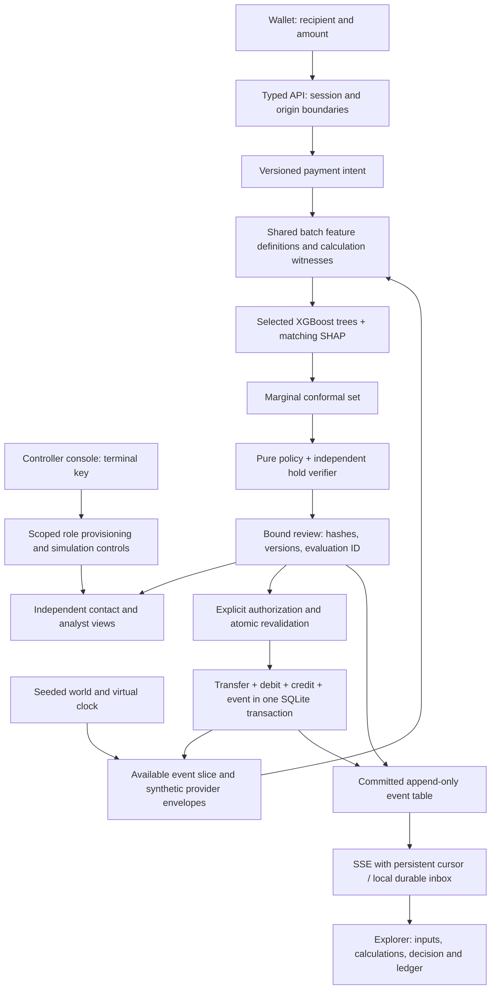

# Local execution architecture

The wallet, decision explorer and console are native browser ES modules served
by one FastAPI process. SQLite persists worlds, intents, immutable reviews,
transfers, ledger, ordered events and hashed role capabilities. No NPCI or bank
connection exists. The previous Streamlit app remains a legacy fixture UI.



```mermaid
sequenceDiagram
  participant U as Payer
  participant A as API
  participant R as Review service
  participant D as SQLite
  participant H as Analyst
  U->>A: Create or edit intent
  A->>D: Persist revision and input event
  U->>A: Request review
  A->>R: Session, payment and request ID
  R->>D: Read world and intent snapshot
  R->>R: Features, model, SHAP, uncertainty, policy
  R->>D: Recheck snapshot and persist immutable review
  alt Active hold
    R-->>U: Hold and server virtual-time eligibility
    Note over U,H: Expiry requires a new review; approval is bound to its ID
    H->>A: Independently approve exact review
    A->>D: Approval actor, review ID and audit event
  end
  U->>A: Authorize exact review, confirm warning
  A->>D: BEGIN IMMEDIATE; verify bindings, timer, approval and balance
  A->>D: Transfer + two ledger entries + settled event; COMMIT
  A-->>U: Existing or newly committed receipt
  D-->>U: SSE cursor exposes committed stages
```

## Contracts and transaction boundaries

Payment state is `pending -> completed` or `pending -> cancelled`, with no exit
from a terminal state. Review validity, hold eligibility and analyst approval
are separate properties. A review binds intent revision, recipient, amount,
direction, consent/text, evidence revision, versions and virtual expiry. An
analyst approval also binds the exact review ID. Observer/contact actions never
authorize settlement. Re-review after approval needs approval for the new ID.

Intent ID is the durable settlement idempotency key; a retry with the same
review returns the original transfer. A different review cannot reuse a settled
intent. `BEGIN IMMEDIATE` serializes competing database connections. Transfer
and ledger/event writes commit together, so retry after a lost response cannot
duplicate debit. Unique ledger entries and update-rejection triggers add checks.

The local `sim_event` table is also the durable notification source: SSE reads
committed rows, reconnects resume after `Last-Event-ID`, contact acknowledgment
persists a cursor. This is an equivalent local durable inbox, not an external
message relay. No claim of exactly-once network delivery is made. A future
external transport needs a separate outbox worker with retries and deduplication.

Stages share evaluation/request/payment/world IDs. Model-stage timing includes
XGBoost, calibration and SHAP; the uncertainty event records the already computed
set and does not claim another model execution. Review timing excludes final
commit/network/rendering. `Server-Timing` measures API handler duration, not bank
network latency. Stage failures persist with the same evaluation ID.

## Feature compatibility and provenance

See [FEATURE_CONTRACT.md](FEATURE_CONTRACT.md). Current graph semantics are
explicitly retained; the deck's reverse direction is not silently substituted.
The model manifest hashes current model/calibration artifacts. Inference version
`selected-tree-explanations-v2` distinguishes the corrected explanation path.
Historical reviews remain readable; incompatible recomputation/authorization is
rejected. The original implementation used all trees for SHAP while scoring used
early stopping; the corrected path requires sigmoid(sum SHAP + base) to match
the score, with a regression assertion in the actual-model test.

## Boundaries and scaling

Modules separate API, access, simulation, features/witnesses, provider envelopes,
model/policy, ledger orchestration, browser rendering and offline evaluation.
SQLite and the process lock suit a local demo. JSON world storage and recomputing
small histories are not a production feature store. Network streaming is polling,
not a high-throughput broker. Multi-process operation, an external identity
provider, database migrations, indexed event storage and a notification relay are
separate deployment work. Adding cloud services before measuring these needs
would not establish bank readiness.
